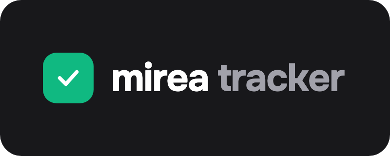

---

Трекер контрольных за семестр: баллы, сданные КР, посещения и план, как закрыть предмет досрочно.


**[mirea-tracker.vercel.app](https://mirea-tracker.vercel.app)**

## Зачем

В течение семестра по каждому предмету копятся контрольные, практики, баллы и сроки, и быстро перестаёшь понимать, сколько осталось до зачёта. Приложение собирает всё в одном месте и отвечает на главный вопрос: **что сдать, чтобы закрыть предмет как можно раньше**.

- все КР и тесты по всем предметам с дедлайнами и статусами
- баллы и посещения лекций с автоматическим подсчётом
- план досрочного зачёта: какие КР закрыть первыми, какие можно пропустить, сколько лекций посетить, с учётом штрафа за просрочку
- шаблоны предметов группы, чтобы не заводить всё вручную

Регистрации нет: данные хранятся только в вашем браузере и переносятся между устройствами экспортом и импортом `.json`.

## Как выглядит

**Все предметы**: прогресс, баллы и ближайший дедлайн по каждому.


**Предмет**: план на зачёт и отметки по КР и практикам.


**Чек‑лист**: все КР и тесты одним списком.


## Структура

Архитектура [Feature-Sliced Design](https://feature-sliced.design): слой импортирует только слои ниже себя.

```
src/
├── app/        маршруты Next.js: главная, предмет, новый предмет, чек-лист, шаблоны
├── views/      страницы целиком
├── widgets/    сводка, шапка предмета, план, раздел чек-листа
├── features/   действия: добавить предмет, отметить КР и посещения, план, редактор, шаблоны, импорт и экспорт
├── entities/   subject: типы, схема zod, хранилище в localStorage, расчёт сводки и плана
└── shared/     ui-компоненты, утилиты, константы
```

## Запуск

```bash
pnpm install
pnpm dev
```

`pnpm check` прогоняет lint, проверку типов и сборку.
