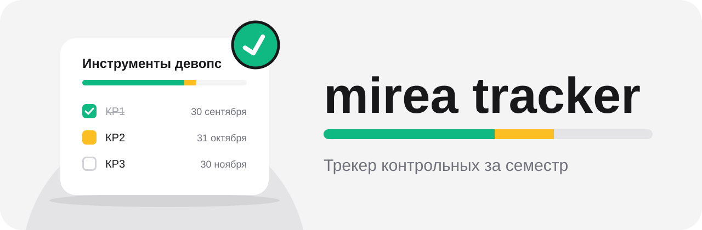

<p align="center">
  
</p>

# mirea tracker

**Трекер контрольных работ, баллов и посещений за семестр.**

«mirea tracker» открывается в браузере. Им можно пользоваться [онлайн](https://mirea-tracker.vercel.app) или запустить на своём компьютере. Регистрация не нужна: данные хранятся только в вашем браузере и никуда не отправляются.

Приложение находится в разработке. План досрочного зачёта временно отключён и вернётся в следующих версиях.

## О приложении

На главной странице собраны все предметы семестра. По каждому видно, сколько контрольных и практик уже закрыто, сколько набрано баллов и когда ближайший срок. Отдельный чек-лист показывает все КР и тесты одним списком.

У каждой контрольной есть проходной балл, срок и статус: не сделано, не защищено или сделано. Практики отмечаются внутри своей КР, посещения лекций отдельно. Баллы за контрольные и лекции подсчитываются автоматически.

Предметы группы можно добавить из готовых шаблонов с контрольными и сроками, а свои создать вручную. Чтобы перенести данные на другое устройство, их можно выгрузить в файл `.json` и загрузить обратно.

## Как выглядит

Главная страница с прогрессом, баллами и ближайшим сроком по каждому предмету.


Страница предмета с баллами, статусами КР и практик и посещениями.


Чек-лист со всеми КР и тестами одним списком.


## Как начать

### Онлайн

Приложение доступно по адресу [mirea-tracker.vercel.app](https://mirea-tracker.vercel.app). Установка не требуется.

### Локальная установка

Потребуются [Git](https://git-scm.com/downloads), [Node.js](https://nodejs.org/) 24 или новее и [pnpm](https://pnpm.io/installation).

```bash
git clone https://github.com/vleypi/mirea-tracker.git
cd mirea-tracker
pnpm install
pnpm dev
```

После запуска приложение доступно по адресу [http://localhost:3000](http://localhost:3000). Команда `pnpm check` прогоняет lint, проверку типов и сборку.

Данные хранятся в браузере отдельно для каждого адреса, поэтому у онлайн-версии и локальной они свои. Перенести их можно экспортом и импортом.

## Структура

```
mirea-tracker/
├── docs/                  баннер и скриншоты для README
├── src/                   приложение, слои Feature-Sliced Design
│   ├── app/               маршруты Next.js: главная, предмет, новый предмет, чек-лист, шаблоны
│   ├── views/             страницы целиком
│   ├── widgets/           крупные блоки: сводка на главной, шапка предмета, раздел чек-листа
│   ├── features/          действия: добавить предмет, отметить КР и посещения, редактор, шаблоны, импорт и экспорт
│   ├── entities/          сущность subject: типы, схема zod, хранилище в localStorage, подсчёт сводки
│   └── shared/            ui-компоненты, утилиты, константы
├── eslint.config.mjs      правила ESLint
├── next.config.ts         настройки Next.js
├── postcss.config.mjs     подключение Tailwind CSS
├── tsconfig.json          настройки TypeScript и алиас @/
└── package.json           зависимости и скрипты
```

Слои [Feature-Sliced Design](https://feature-sliced.design) идут сверху вниз: слой импортирует только слои ниже себя.
