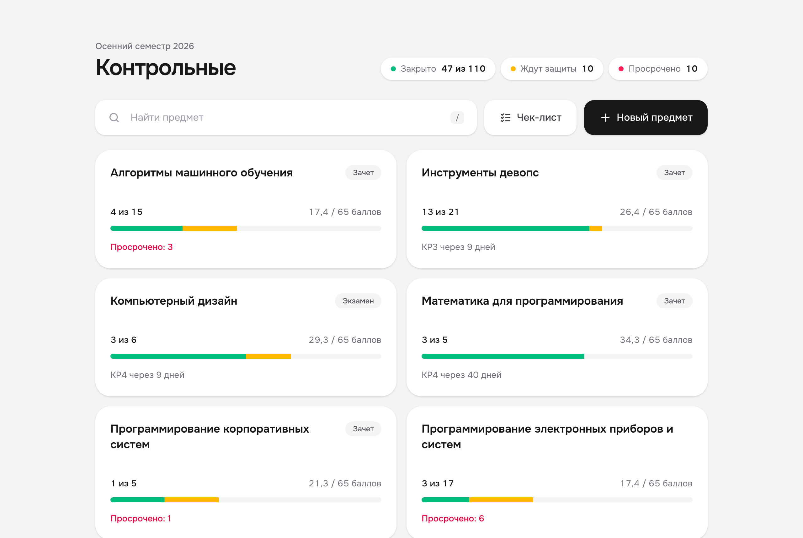
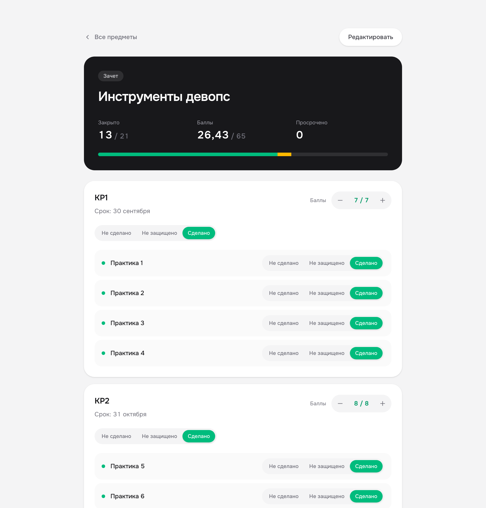
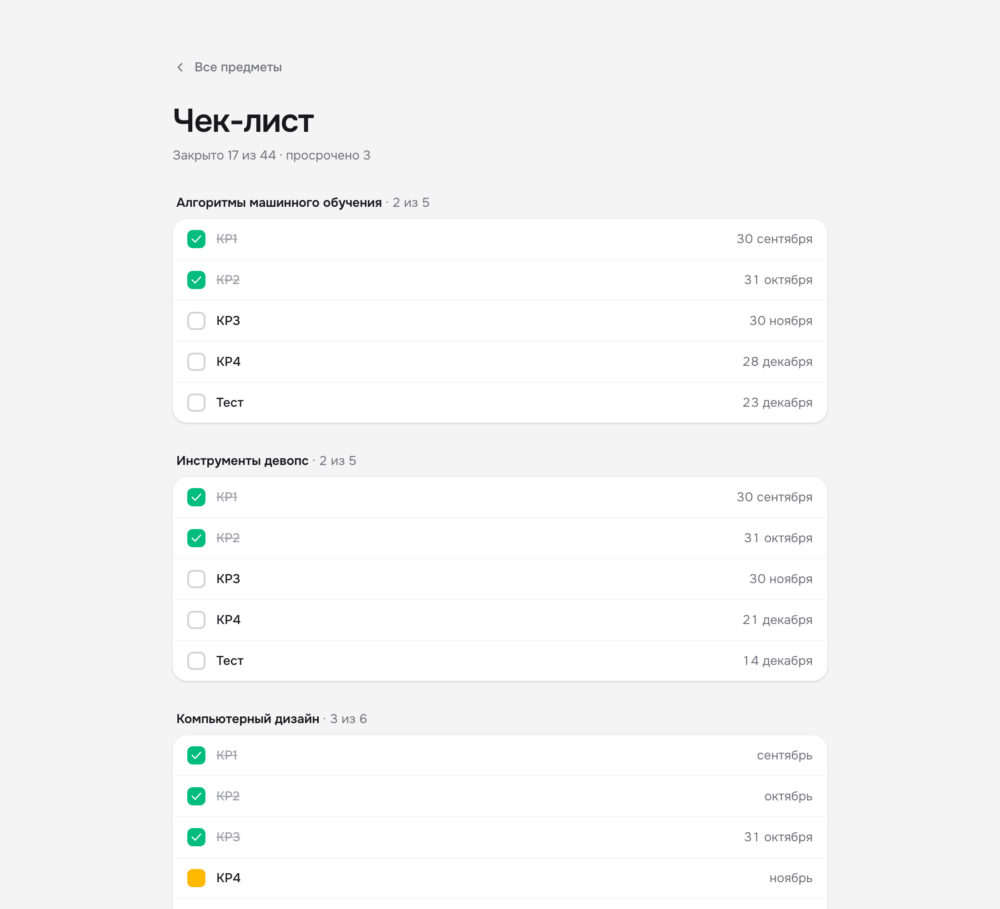

---

Трекер контрольных за семестр: предметы, КР и практики со сроками, баллы и посещения лекций.


**[mirea-tracker.vercel.app](https://mirea-tracker.vercel.app)**

## Что делает

- показывает все предметы семестра с прогрессом, баллами и ближайшим дедлайном
- хранит по каждому предмету контрольные, тесты и практики со сроками и статусом: не сделано, не защищено, сделано
- считает баллы за контрольные и посещения лекций
- собирает все КР и тесты в общий чек-лист
- добавляет предметы группы из готовых шаблонов
- работает без регистрации: данные хранятся в браузере и переносятся между устройствами экспортом и импортом `.json`

## Как выглядит

**Все предметы**: прогресс, баллы и ближайший дедлайн по каждому.



**Предмет**: баллы, статусы КР и практик, посещения.



**Чек‑лист**: все КР и тесты одним списком.



## Структура

```
mirea-tracker/
├── docs/                  логотип и скриншоты для README
├── src/                   приложение, слои Feature-Sliced Design
│   ├── app/               маршруты Next.js: главная, предмет, новый предмет, чек-лист, шаблоны
│   ├── views/             страницы целиком
│   ├── widgets/           крупные блоки: сводка на главной, шапка предмета, раздел чек-листа
│   ├── features/          действия: добавить предмет, отметить КР и посещения, редактор, шаблоны, импорт и экспорт
│   ├── entities/          сущность subject: типы, схема zod, хранилище в localStorage, подсчёт сводки
│   └── shared/            ui-компоненты, утилиты, константы
├── eslint.config.mjs      правила ESLint
├── next.config.ts         настройки Next.js
├── postcss.config.mjs     подключение Tailwind CSS
├── tsconfig.json          настройки TypeScript и алиас @/
└── package.json           зависимости и скрипты
```

Слои [Feature-Sliced Design](https://feature-sliced.design) идут сверху вниз: слой импортирует только слои ниже себя.

## Запуск

```bash
pnpm install
pnpm dev
```

`pnpm check` прогоняет lint, проверку типов и сборку.
